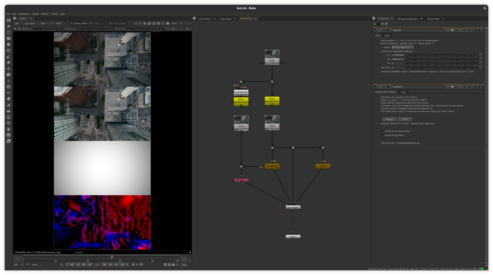

# bamDeVe 1.0

Developed by Erik Schneider / erik@bewegtbildbau.de
Developed at Lumatic / https://lumatic.xyz/

Estimate a lens vignette from motion entirely inside Nuke.

It generates the vignette from seeing the same thing at different screen positions.
Therefore not every plate is suitable to achieve a good result.
Camera motion and few lighting changes will most likely give the best results.
If you have multiple plates per lens pick the plate that fits this description most and reuse the Vignette for the rest.
It supports spherical and anamorphic lenses.
There is also a CLI version if you want to integrate it into a pipeline.

A big thank you to Lumatic for allowing me to share this!

## How it works
You pre-render optical flow (SmartVector or Cattery RAFT) to disk, wire the plate + flow
read nodes, and hit **Analyse** and then **Solve**. The button reads the EXRs straight off disk
and fits a vignette formula with a statistical analyses.



The test footage in the screenshot is from ARRI's
[camera sample footage](https://www.arri.com/en/learn/camera-systems/camera-sample-footage-reference-image).

## Files
- `bamDeVe.nk` — the gizmo
- `menu.py` — adds **bam → bamDeVe** to the Nodes toolbar and the menu bar.
- `vignette_solve.py` — Analyse / Solve: probe, scan, solve and the Vignette node.
- `vignette_fit.py` — numpy-only solver, correspondence building and scoring.
- `exr_read.py` — pure-Python EXR reader.
- `solve_cli.py` — the same Analyse + Solve headless, outside Nuke (optional).

## Dependencies

You need to have numpy available in Nuke.
Example of how to install numpy for Nuke:

~/Nuke17.1v2/python3 -m pip install numpy

Add this folder to your `NUKE_PATH`
or place something like this in your init.py:

```
bamDeVe = os.path.join(
    os.path.expanduser("~"), "bamDeVe", "nuke_tools"
)
if os.path.isdir(bamDeVe):
    nuke.pluginAddPath(bamDeVe)
```

Nuke then runs `menu.py` on startup and the tool is under **bam → bamDeVe**
(Nodes toolbar, menu bar and Tab search). It is pasted connected to the selected node.

The reader supports single-part scanline EXRs with HALF/FLOAT channels and
**NONE / RLE / ZIPS / ZIP** compression (ARRI/ACES plates are ZIPS; Nuke's default
is Zip). If a plate/flow uses PIZ / PXR24 / DWA, re-write it through a Nuke Write
set to **"Zip (16 scanline)"**.
